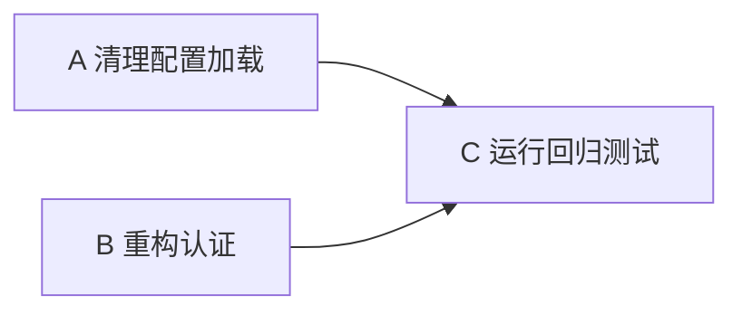

# s13 Agent Teams 学习笔记

s13 把 s10 的任务板交给多个 Agent 一起使用。**任务板记录谁负责什么，收件箱传递进展和结果，每个 Agent 用自己的对话历史工作。** 队友做完一项后可以继续接下一项，直到 Lead 请求它退出。

这一节用同一个例子串起完整流程。

> 重构示例后端的配置加载和认证逻辑，保持现有接口，最后跑回归测试。

示例中的任务 ID、目录和模型回复都是演示数据。实际运行时，使用工具返回的任务 ID。课程源码见 [code.py](code.py)。

## 复习导航

- [Lead 怎样把需求拆成团队任务](#1-lead-怎样把需求拆成团队任务)
- [队友怎样工作、Lead 怎样收到结果](#2-队友怎样工作lead-怎样收到结果)
- [前置任务完成后谁来接测试](#3-前置任务完成后谁来接测试)
- [worktree 怎样为任务选择工作目录](#4-worktree-怎样为任务选择工作目录)
- [Lead 怎样审批计划](#5-lead-怎样审批计划)
- [队友怎样退出](#6-队友怎样退出)
- [速查和复习问答](#7-速查和复习问答)

| 数据 | 保存在哪里 | 例子 |
| --- | --- | --- |
| 共享任务 | `.tasks/<任务 ID>.json` | 认证任务归 `bob`，状态为 `in_progress` |
| 待投递消息 | `.mailboxes/<收件人>.jsonl` | `bob` 给 `lead` 发来认证重构结果 |
| 模型的对话上下文 | 各 Agent 自己的 `messages` | `bob` 读过哪些文件、拿到了哪些工具结果 |

队友通过 Python 线程运行。每个队友有自己的系统提示、对话历史和工具调用循环。Lead 和队友可以使用同一个模型配置，每次调用给模型看的上下文各有分工。

## 1. Lead 怎样把需求拆成团队任务

Lead 的系统提示要求它先提出分工、等用户确认，再启动队友。例如，Lead 提议让 `alice` 改配置、让 `bob` 改认证。用户回复「开始吧」，Lead 才按计划调工具。这一步属于系统提示对模型的约束，`spawn_teammate` 的工具参数中没有用于校验用户确认的字段。

| 任务 | 示例 ID | 前置任务 |
| --- | --- | --- |
| A 清理配置加载 | `task_aaaaaaaa` | 无 |
| B 重构认证 | `task_bbbbbbbb` | 无 |
| C 运行回归测试 | `task_cccccccc` | A 和 B 都要完成 |



任务图沿用 s10 的两步流程。先调 `create_task` 创建三个任务，拿到真实 ID，再调 `update_task` 给 C 加上 A 和 B 的 ID。队友可以列出、认领、完成共享任务。Lead 持有创建任务和修改依赖的工具。

假设 Lead 给 `bob` 分派 B。

```python
spawn_teammate(
    name="bob",
    role="backend",
    prompt="重构认证逻辑，保持现有接口。",
    task_id="task_bbbbbbbb",
)
```

Python 先检查队友名字，再用 `bob` 的身份认领 B，认领成功后才启动线程。任务文件和 `bob` 第一条消息会发生以下变化。

```text
启动前
B.status = pending
B.owner  = null

认领并启动后
B.status = in_progress
B.owner  = bob

bob 的第一条消息
重构认证逻辑，保持现有接口。

[Assigned task task_bbbbbbbb] 重构认证
……任务描述……
Work directory: ……
```

如果 B 已被别人认领，或者前置工作还没完成，带这项初始任务的启动会被拒绝。省略 `task_id` 时，队友可以先运行初始回合，随后等待消息或接任务。队友使用文件或 Shell 工具前需要有任务分配。

对应源码见 [Lead 的系统提示](code.py#L641) 和 [spawn_teammate_thread](code.py#L1384)。

## 2. 队友怎样工作、Lead 怎样收到结果

`bob` 启动后进入自己的 `TeammateRuntime.work()`。它沿用前几节的 Agent Loop，给模型传的是 **`bob` 的 `messages` 和 `TEAMMATE_TOOLS`**。

```text
bob 的模型请求读取 auth.py
    ↓
Python 读文件，把正文放进 bob 的 messages
    ↓
bob 的模型根据正文提出修改
    ↓
Python 执行工具，把结果继续放进 bob 的 messages
    ↓
bob 调用 complete_task 登记完成，然后给出最终文字
```

`auth.py` 的工具输出留在 `bob` 的历史里。假设 `bob` 最终回复「认证逻辑已整理，公开接口保持一致，局部检查通过」，运行时会把这段文字写进 `.mailboxes/lead.jsonl`。其中一行可以简化成下面这样，实际记录还有时间戳。

```json
{"from":"bob","to":"lead","type":"result","content":"认证逻辑已整理，公开接口保持一致，局部检查通过。","metadata":{}}
```

在这个例子的常规完成路径上，运行时先发 `result`，再发 `idle_notification`。回顾时看清这三项分别表示什么。

| 看到的内容 | 可以确定什么 |
| --- | --- |
| `result` | `bob` 报告了哪些成果 |
| `idle_notification` | `bob` 进入了等待阶段 |
| 任务文件中的 `status=completed` | `complete_task` 成功登记了完成状态 |

例如模型说「改完了」但漏调 `complete_task`，Lead 可以收到成果报告，B 仍可能是 `in_progress`，依赖它的 C 会继续等待。

Lead 的 CLI 等待时会检查收件箱。发现来信后，`consume_lead_inbox()` 读取并移除收件箱文件，CLI 再把事件追加到 Lead 的历史中。如果两条事件刚好在同一批被取到，模型会看到类似内容。

```text
[Team events]
[result] bob: 认证逻辑已整理，公开接口保持一致，局部检查通过。
[idle_notification] bob: Waiting for more work.
```

随后 CLI 自动开启一轮 Lead 调用。Lead 启动队友后可以结束当前回合，等收件箱事件唤起下一轮。如果 Lead 正在调用模型或执行工具，来信会留在收件箱，等 CLI 回到等待流程再投递。

对应源码见 [MessageBus](code.py#L852)、[TeammateRuntime.work](code.py#L1271) 和 [wait_for_cli_event](code.py#L1836)。

## 3. 前置任务完成后谁来接测试

假设 `bob` 先做完认证，`alice` 还在改配置。此时任务板的状态如下。

```text
A 配置   in_progress   alice
B 认证   completed     bob
C 测试   pending       无负责人，仍在等 A
```

`bob` 进入 `wait_for_work()`。它先等收件箱消息，默认等待最多 2 秒。如果收到 Lead 的消息，就先处理消息。如果等到超时仍无消息，再去看共享任务板。

A 也完成后，C 的前置条件全部满足。假设 `alice` 和 `bob` 都扫到了 C，两个队友会分别尝试认领。

```text
alice 扫描任务板 → 看到 C 是 pending
bob   扫描任务板 → 也看到 C 是 pending

alice 先拿到任务存储锁
    重新读取 C → 仍然可用
    保存 C.status = in_progress，C.owner = alice
    释放锁

bob 后拿到任务存储锁
    重新读取 C → 已经是 in_progress
    本次认领被拒绝
```

**扫描提供候选，锁内重新读取和校验的结果决定归属。** `task_store_lock()` 用进程内锁协调线程，用 `.tasks/.lock` 文件锁协调使用同一任务目录的进程。任务 JSON 先写进临时文件，再用 `os.replace()` 替换正式文件。锁把读、检查、写保护在同一段操作里。

`claim_task()` 还会检查队友是否已经持有当前工作分配、是否有别的进行中任务，以及该任务的工作目录能否使用。认领成功后，运行时给 `alice` 原来的 `messages` 加一条消息。

```text
[Auto-claimed task task_cccccccc] 运行回归测试
验证配置加载和认证重构后的行为。
Work directory: ……
```

`alice` 接 C 时继续使用原来的线程和消息列表，因此仍可参考 A 阶段的上下文。这也是 s13 与 s06 一次性 subagent 的区别。

对应源码见 [claim_task](code.py#L281) 和 [wait_for_work](code.py#L1322)。

## 4. worktree 怎样为任务选择工作目录

回到 B 还没被认领的时候。假设 Lead 希望让 `bob` 在单独目录里改认证，可以先调用 `create_worktree`。任务需要处于 `pending`、无人认领且尚未绑定目录。

```python
create_worktree(name="auth-refactor", task_id="task_bbbbbbbb")
```

成功后，Git 创建 checkout 和分支，Python 把绑定写入任务记录。

```text
Git
创建 .worktrees/auth-refactor/
创建分支 wt/auth-refactor，起点为当前 HEAD

任务板
B.worktree = "auth-refactor"
```

等 `bob` 认领 B，运行时保存当前任务与目录的对应关系。

```python
teammate_assignments["bob"] = {
    "task_id": "task_bbbbbbbb",
    "cwd": "/project/.worktrees/auth-refactor",
}
```

同样一句 `read_file("auth.py")`，`alice` 在未绑定 worktree 的 A 上会读仓库里的文件，`bob` 在 B 上会读自己的 checkout。`bash` 的默认工作目录也跟着任务走。绑定损坏时，认领或工具调用会报错。worktree 分隔 Git checkout 和默认工作目录，Shell 仍使用父进程已有的权限。

把这个变化代回 C。**A 和 B 完成会让 C 可认领，B 的代码仍在自己的 checkout 里。** 如果 C 在主工作目录运行，它只能测试该目录中已有的代码。为了验收两份改动，可以让 Lead 先汇合改动，或安排 C 在已经包含两份改动的目录运行。如果要靠任务板控制顺序，可以在任务图里加一个集成步骤，等集成完成再放行最终测试。

还有一个时间点容易混淆。`bob` 成功调用 `complete_task(B)` 后，B 立刻变成 `completed`，当前目录分配保留到 `bob` 的工作回合结束。这一轮里的后续检查仍能访问原目录。worktree 的移除由宿主函数处理，清理前会检查任务状态、目录是否仍在使用以及 Git 改动。

对应源码见 [create_worktree](code.py#L489) 和 [release_completed_assignment](code.py#L457)。

## 5. Lead 怎样审批计划

以 `bob` 的认证任务为例，Lead 可以在启动时传入 `require_plan=True`，也可以给已运行的队友调用 `request_plan`。启动时传参会在线程开始前设置审批状态。假设 `bob` 先读代码，提交一份计划，内容是保留函数签名、整理重复判断、再做局部检查。

| 步骤 | `bob` 的计划状态 | 工具怎样处理 |
| --- | --- | --- |
| Lead 要求先给计划 | `required` | 可以读文件、找文件和提交计划。`bash`、写入和编辑受限 |
| `bob` 调用 `submit_plan` | `pending` | 生成请求 ID，把计划送到 Lead，等待决定 |
| Lead 要求修改，`bob` 收到回复 | `rejected` | 修改工具继续受限。`bob` 可以调整并重新提交 |
| Lead 批准当前计划，`bob` 收到并验证回复 | `approved` | 修改工具继续走常规权限检查 |

`complete_task` 也会检查计划状态。计划处于 `required`、`pending` 或 `rejected` 时，队友无法把任务登记为完成。`bash` 工具整体受审批约束，所以查看类 Bash 命令也得先通过这一步。需要交互确认的工具操作由 Lead 与用户处理，队友线程不会直接读取终端的批准输入。

假设 `bob` 在 B 上提交了 `req_123456`，后来已经换了任务，旧批准才到达。程序会核对 `request_id`、发件人、收件人、`task_id` 以及当前工作分配的版本。旧请求即使写着批准，也无法为新任务解除限制。**Lead 发出批准后，`bob` 还要收到并应用这条回复，修改工具才会按新的审批状态运行。**

对应源码见 [_teammate_submit_plan](code.py#L1011)、[_run_teammate_tool](code.py#L1038) 和 [apply_plan_response](code.py#L1060)。

## 6. 队友怎样退出

普通 `send_message` 用于传递工作信息。工作结束后，Lead 用 `request_shutdown("bob")` 请求关闭 `bob` 的线程。这次通信带有结构化的消息类型和请求 ID。

```text
Lead 登记一个 pending 的关机请求
    ↓
shutdown_request → bob 的收件箱
    ↓
bob 在检查收件箱时核对请求，进入 stopping
    ↓
shutdown_response → lead 的收件箱
    ↓
bob 退出循环，清理运行记录
    ↓
Lead 消费回复，用 request_id 确认原来的请求
```

`bob` 正在等待 Shell 命令时，要等当前这批工具执行结束，再到后续工作边界检查收件箱。如果线程退出时仍拥有一个 `in_progress` 任务，清理函数会尝试把它改回 `pending` 并清除负责人，其他队友之后就可以接手。已经写进磁盘的代码修改需要由下一位执行者检查。

对应源码见 [apply_shutdown_request](code.py#L1091) 和 [TeammateRuntime.run](code.py#L1348)。

## 7. 速查和复习问答

| 想确认什么 | 看哪里 |
| --- | --- |
| 认证任务归谁、做到了哪里？ | `.tasks/` 中的 `owner` 和 `status` |
| `bob` 给 Lead 发了什么？ | 待处理时看 `.mailboxes/lead.jsonl`，投递后看 Lead 历史的 `[Team events]` |
| 两个队友都想接测试，谁接到了？ | `claim_task()` 锁内检查后的任务文件 |
| `bob` 的文件工具在哪个目录运行？ | `teammate_assignments` 和 `assignment_cwd()` |
| `bob` 为什么能读文件，却无法修改？ | `plan_gates` 和 `_run_teammate_tool()` |

**1. Lead 收到 `result` 后，C 一定可以开始了吗？** 看任务板。只有 C 的所有前置任务都通过 `complete_task` 登记完成，它才具备认领条件。

**2. `alice` 和 `bob` 都扫到了 C，为什么只会有一个人认领成功？** 认领会拿锁并重新读取任务。后拿锁的队友看到的是已经更新过的 `owner` 和 `status`。

**3. `bob` 发来完成消息，会唤起 Lead 吗？** CLI 回到等待流程后会消费来信并启动下一轮，Lead 正忙时来信会先留在收件箱。

**4. B 在 worktree 中完成，C 在主目录跑测试能覆盖 B 的改动吗？** 主目录需要先包含 B 的改动，或者让 C 改到包含这些改动的目录运行。任务完成只会推进任务板状态。

**5. Lead 已批准计划，为什么 `bob` 的写入可能仍然受限？** `bob` 需要先从收件箱取到回复，再核对它属于当前任务和计划，最后才更新 `plan_gates`。

**6. 队友关机时工作还没完成，下次怎样接手？** 清理逻辑尝试把进行中任务归还任务板。下一位队友可以重新认领，再检查之前留下的文件改动。

此前讲解用仓库已有的 9 项相关测试核对过启动前认领、收件箱投递、并发认领、计划审批、worktree 目录和退出清理，均已通过。这里的后端重构用于串联示例，测试覆盖的是团队运行时行为。
