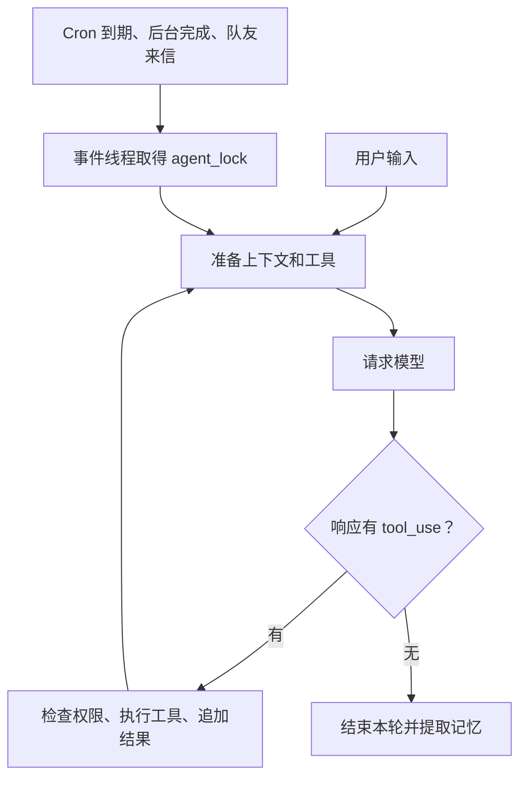

# s15 Integrated Harness 学习笔记

**s15 把前几节的功能接到同一个 Lead 循环里。** 模型决定下一步，Python 准备上下文和工具、执行工具，再把结果交还模型。用户输入能启动一轮，后台命令完成、Cron 到期、队友来信也能唤起一轮。源码见 [code.py](code.py)。

## 复习导航

- [主循环和三个输入](#1-主循环和三个输入)
- [跟一遍后台跑测试的例子](#2-跟一遍后台跑测试的例子)
- [后台、定时和队友怎样唤起 Lead](#3-后台定时和队友怎样唤起-lead)
- [待办、子 Agent 和共享任务](#4-待办子-agent-和共享任务)
- [上下文压缩和模型调用恢复](#5-上下文压缩和模型调用恢复)
- [源码速查和复习问答](#6-源码速查和复习问答)

## 1. 主循环和三个输入

读这个文件时，可以先看末尾的 `agent_loop()`。它把事件、模型调用和工具执行接成下面的流程。



用户回合和异步回合共享 Lead 的 `history`，运行时用 `agent_lock` 串行处理它们。队友在各自的线程和对话历史里工作。

每次请求 Lead 模型前，程序准备好三项数据。

| 字段 | 放了什么 | 例子 |
| --- | --- | --- |
| `system` | 工作规则、当前目录、技能目录、相关记忆与已连接的 MCP 服务名 | 「用户喜欢先看到验证结果」可以作为相关记忆放在这里 |
| `messages` | 用户请求、模型回复、工具结果和已经投递的事件 | 「读取 README 得到的内容」和「后台测试完成」进入这里 |
| `tools` | 这一轮可选工具及其参数定义 | `read_file`、`bash`、`connect_mcp`，以及连接后出现的 `mcp__docs__search` |

**Skill、Memory 和 MCP 在这里的落点不同。**

- **Skill** 的目录进入 `system`。模型调用 `load_skill` 后，完整说明以工具结果进入 `messages`。
- **Memory** 直接复用 s09 的实现。`update_context()` 每轮准备模型请求时挑选相关记录，正文可以加入 `system`。正常结束回合时，程序提取可能值得长期保留的信息，有新增记录时再检查是否要整理。
- **MCP** 连接后，`assemble_tool_pool()` 给下一轮的 `tools` 增加服务工具，也给 Python 增加名称到处理函数的映射。已连接的服务名会一同出现在 `system`。

另外，Python 自己保留 `handlers`，用它根据工具名找到实际执行函数。模型收到的是 `tools` 里的定义。对应源码见 [系统提示组装](code.py#L848)、[工具池组装](code.py#L2754) 和 [主循环](code.py#L3139)。

## 2. 跟一遍后台跑测试的例子

> 查一下文档里的测试说明，后台运行 `pytest -q`，等待期间读 `README.md`。测试结束后告诉我结果。

下面的模型回复和测试输出都是演练数据。可以把模型的每一次调用当作一轮，然后看数据怎么变。

### 第 1 轮连接服务

模型起初收到 26 个内置工具，选择 `connect_mcp(name="docs")`。Python 把 `docs` 客户端登记到 `mcp_clients`，并把「发现 `search` 和 `get_version`」作为 `tool_result` 追加到 `messages`。

### 第 2 轮查询文档

程序重新组装工具池，模型现在收到 **28 个工具**，多了 `mcp__docs__search` 和 `mcp__docs__get_version`。它可以调用 `mcp__docs__search(query="pytest")`，得到模拟返回 `[docs] Found 3 results for 'pytest'`。

和 s14 一样，课程里的 `docs` 是进程内模拟服务，返回的是结果数量。这里使用的 `pytest -q` 来自用户请求，随后读取的 README 也会显示该命令。

### 第 3 轮同时请求跑测试和读文件

模型在一条回复里提出两个工具调用，以下是简化表示。

```text
bash(command="pytest -q", run_in_background=true)
read_file(path="README.md")
```

主循环按顺序处理这一批。`bash` 先触发 `PreToolUse`。在这个前台用户回合里，Shell 命令要经用户确认。用户批准后，程序登记 `bg_0001`、启动后台线程，并立即拿到一条启动回执。主循环接着执行 `read_file`。

```text
bash 的 tool_result      [Background task bg_0001 started]
read_file 的 tool_result 验证方式：pytest -q
```

因此测试还在跑时，README 的内容已经可以交给模型。每一份工具结果仍用 `tool_use_id` 对应自己的原始调用。模型可以先回复「测试已启动，README 已读」，结束当前回合。对应源码见 [权限 Hook](code.py#L1797) 和 [工具分发](code.py#L3210)。

### 测试结束后，用户无需再输入

后台线程执行完 `pytest` 后，把状态和输出保存起来。若主循环仍在工作，工具结果组装或下一轮循环顶部便可以收走结果。若原回合已经结束，事件线程会发现有终态结果待交付，取得 `agent_lock` 后开启一轮。

模型这时可以看到下面的文本通知。

```xml
<task_notification>
  <task_id>bg_0001</task_id>
  <status>completed</status>
  <command>pytest -q</command>
  <summary>12 passed</summary>
</task_notification>
```

启动回执回答「任务启动了吗」，完成通知回答「任务执行结果如何」。完成通知作为普通文本块加到 `messages`，用 `bg_0001` 关联先前的回执。领取时，Python 会在锁内移除完成项，避免两条收集路径为同一结果各追加一份通知。通知摘要最多取输出的前 200 个字符。对应源码见 [后台启动](code.py#L2298)、[结果领取](code.py#L2350) 和 [消息组装](code.py#L3110)。

## 3. 后台、定时和队友怎样唤起 Lead

`async_event_loop()` 大约每秒检查一次。在取得 `agent_lock` 后，它查看是否有到期定时任务、Lead 收件箱消息或已完成的后台结果。有可处理事件才启动主循环。原有用户回合正在运行时，事件线程需要等它释放锁。

| 事件来源 | 在哪一步放入 Lead 的历史 | 模型看到什么 |
| --- | --- | --- |
| 后台命令结束 | 由 `agent_loop()` 顶部或工具结果组装处读取 | `<task_notification>`，例如测试的完成状态和输出摘要 |
| Cron 到期 | `agent_loop()` 循环顶部消费 `cron_queue` | `[Scheduled] 查一下 web 服务状态。` |
| 队友来信 | 事件线程消费 Lead 收件箱，并在入主循环前追加 | `[Team events]`，里面可以有结果、空闲通知和审批事件 |

### 定时检查 `web` 服务状态

假设用户登记每天 09:00 查询 `web` 状态。Cron 线程匹配到时间后，将请求放进 `cron_queue`。主循环把请求追加成 `[Scheduled]` 消息。模型随后可以连接模拟 `deploy` 服务，再调用宿主策略已放行的 `mcp__deploy__status`。

如果将定时内容改为「运行 `pytest -q`」，异步回合里的 Shell 调用会被权限 Hook 拒绝。这个线程无法读取用户的交互批准。前面的测试例子在前台完成了批准，所以随后可以由后台线程执行。需要交互确认的 MCP 调用在异步回合也会被拒绝。

对一次性定时任务，收到包含这条请求的模型响应后，程序才确认交付并移除规则。实际工具调用还要等后续执行。模型调用最终失败时，未确认的请求会被放回队列。对应源码见 [Cron 调度](code.py#L2546)、[交付确认](code.py#L2570) 和 [主循环](code.py#L3139)。

### 队友审查测试文档

假设用户确认分工，Lead 给 `alice` 一张「检查测试文档」的任务卡。`alice` 在自己的线程里读取文件，写回任务板状态，并报告结果。事件线程取走 Lead 收件箱里的消息后，可以向 Lead 模型提供下面这样的内容。

```text
[Team events]
[result] alice: README 已有测试命令，但缺少测试环境说明。
[idle_notification] alice: Waiting for more work.
```

`result` 表示报告，`idle_notification` 表示队友进入等待。任务是否已经完成，要看任务板上的 `status`。任务绑定 worktree 时，对应工作目录随任务分配给队友。Lead 可以在启动队友后结束当轮，来信之后再继续协调。对应源码见 [队友线程](code.py#L1379) 和 [异步事件循环](code.py#L3273)。

## 4. 待办、子 Agent 和共享任务

| 名字 | 它在程序里做什么 | 可以用在哪一步 |
| --- | --- | --- |
| `todo_write` | 更新当前会话的轻量清单 | 让 Lead 跟踪「查说明 → 跑测试 → 汇报」 |
| `task` | 调用一次性 subagent，Lead 等到它返回文字摘要 | 让子 Agent 快速扫描几份文件，汇总发现 |
| `create_task` | 向 `.tasks/` 写入一张可追踪的任务卡 | 为团队分派可认领、可加依赖的工作 |
| `spawn_teammate` | 启动能持续收消息、等待并接下一项任务的队友线程 | 让 `alice` 审查文档，随后继续处理其他就绪任务 |

一次性 subagent 和队友均有自己的 `messages` 和工具范围。s15 的 Lead、一次性 subagent 和队友的常规工具路径都经过权限与 Hook 检查。对应源码见 [subagent](code.py#L1930) 和 [工具定义](code.py#L2887)。

## 5. 上下文压缩和模型调用恢复

### 请求模型前，先整理消息

假设测试问题排查了很多轮，历史里积累了长日志和文件内容。`prepare_context()` 每轮会运行下面的步骤，后几项按大小决定是否启用。

```text
tool_result_budget   转存最新一批的大工具输出
snip_compact         消息条数达到阈值时归档并裁掉中段
micro_compact        上下文仍太大时缩短旧工具结果
fit_tool_results     仍太大时进一步缩短占空间的工具结果
compact_history      仍超限时请模型总结历史
```

代码用 `len(json.dumps(messages, default=str))` 估算消息大小，50,000 是这个估算口径下的阈值。生成摘要时，`Authoritative request` 放当前请求，`Reference state` 放从旧历史归纳的参考状态。例如「后台运行测试并汇报」放在当前请求中，「此前已读 README」可以放在参考状态中。模型主动调用 `compact` 时，先把这批 `tool_result` 追加完整，再总结历史。对应源码见 [上下文准备](code.py#L3096) 和 [压缩摘要](code.py#L2195)。

### 模型调用异常怎样继续

| 遇到的情况 | 当前代码怎样处理 |
| --- | --- |
| `429` 限流 | 等待后重试，等待时间随尝试次数增加 |
| `529` 服务过载 | 等待后重试。连续过载且配置了 `FALLBACK_MODEL_ID` 时可切换模型 |
| 输入太长 | 当前 `agent_loop()` 尝试一次补救压缩，再请求模型 |
| 输出达到 `max_tokens` | 先从 8,000 提到 16,000。仍然截断时，可保留部分回复并追加继续请求 |

上表的恢复路径针对模型调用。Shell 命令自己的错误会进入工具结果或完成通知，由模型决定接下来如何处理。正常情况下，模型回复没有 `tool_use` 时，主循环触发 `Stop`、提取记忆、释放已完成的 Lead 工作分配，然后返回。对应源码见 [模型重试](code.py#L2244) 和 [恢复与退出分支](code.py#L3171)。

## 6. 源码速查和复习问答

| 复习的问题 | 源码入口 |
| --- | --- |
| 用户输入怎样进入共享历史？ | [CLI 入口](code.py#L3303) |
| 每轮先做什么、后做什么？ | [agent_loop](code.py#L3139) |
| 记忆和技能放在模型请求的哪里？ | [update_context](code.py#L3076)、[assemble_system_prompt](code.py#L848) |
| 连接新服务后，工具什么时候可用？ | [assemble_tool_pool](code.py#L2754) |
| 测试为什么可以边跑边读文件？ | [start_background_task](code.py#L2298)、[工具分发](code.py#L3210) |
| 用户没再发消息，Lead 怎么开始下一轮？ | [async_event_loop](code.py#L3273) |
| 上下文太长和输出截断怎么处理？ | [prepare_context](code.py#L3096)、[模型恢复分支](code.py#L3171) |

**1. `connect_mcp("docs")` 返回成功，模型什么时候真正能调用搜索？** 下次模型调用会重建 `tools` 和 `handlers`，把 `mcp__docs__search` 加进去。

**2. `bg_0001 started` 能证明测试通过吗？** 它表示后台线程已经启动。实际结果要看之后的 `<task_notification>`。

**3. 前台批准后台跑测试，为什么定时回合直接跑测试会被拒绝？** 前者在主线程先完成批准，再启动 worker。后者在异步线程直接提出 Shell 请求，程序无法在那里读取交互批准。

**4. 队友说「改完了」和任务板标为 `completed` 怎样对应？** 结果报告通过收件箱传递，完成状态由任务工具写入。判断依赖是否满足时读任务板。

**5. `task` 和 `create_task` 分别做什么？** 前者执行一次委派并返回摘要，后者创建一条由 Lead 或队友认领的工作记录。

**6. 输入太长和输出被截断，各走哪条恢复路径？** 输入太长走补救压缩。输出被截断先扩大输出预算，随后才考虑发继续请求。
