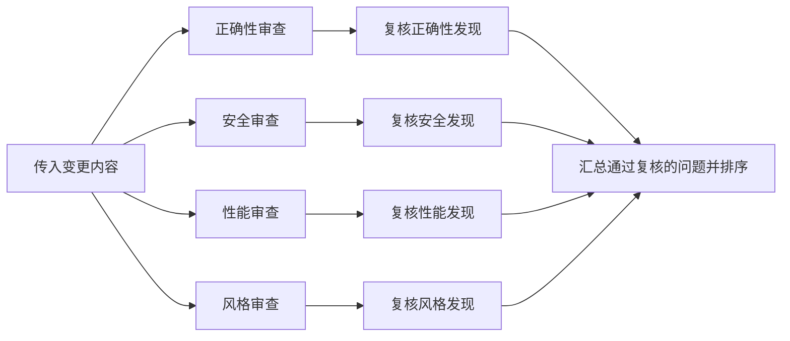

# s16 Workflow Runtime 学习笔记

**s16 把一套多步流程写成 Python 脚本，再通过一个 `Workflow` 工具交给 Agent 调用。** Lead 决定是否运行这套流程，脚本安排步骤和并行关系，模型完成各步骤里的判断。成功的步骤结果会写入日志，续跑时可以直接复用。课程源码见 [code.py](code.py)。

## 复习导航

- [一次 Workflow 调用怎样进入 s15](#1-一次-workflow-调用怎样进入-s15)
- [审查步骤怎样并行和衔接](#2-审查步骤怎样并行和衔接)
- [模型结果怎样交给下一步](#3-模型结果怎样交给下一步)
- [失败以后怎样续跑](#4-失败以后怎样续跑)
- [Lead 什么时候拿到结果](#5-lead-什么时候拿到结果)
- [源码速查和复习问答](#6-源码速查和复习问答)

本节用代码审查贯穿全程。假设用户给出一个改动，把折扣金额从「最后统一取整」改成了「每一行先取整再相加」。用户想从不同维度检查改动，还希望对每条初步发现做一次复核。

## 1. 一次 Workflow 调用怎样进入 s15

Lead 拿到变更内容后，可以提出下面这次工具调用。这里用一句自然语言代替要审查的代码片段，便于看清参数结构。

```json
{
  "name": "Workflow",
  "input": {
    "name": "review-changes",
    "args": {
      "changes": "折扣金额从最后统一取整，改为每一行先取整再相加。"
    }
  }
}
```

| 字段 | 含义 |
| --- | --- |
| 外层 `name` | 调用的工具名 `Workflow` |
| `input.name` | 选用的已登记工作流 `review-changes` |
| `input.args` | 交给脚本处理的数据，例如变更代码或说明 |
| `input.resume_from_run_id` | 可选。传入已有运行 ID 时，续跑那次工作流 |

程序用 `input.name` 到 `WORKFLOWS` 查找宿主登记好的元数据和函数。当前课程登记的是 `review-changes`，对应 `sample_workflow()`。工作流的脚本、名称和进度阶段由宿主管理。模型传入工具参数，宿主从登记表选代码来执行。未知的工作流名称会被拒绝。

`install_workflow_tool()` 包装了 s15 的 `assemble_tool_pool()`，给原工具列表增加 `Workflow`，给执行映射增加 `run_workflow_sync`。这样 s15 原来的模型调用、工具分发和 `tool_result` 流程可以继续使用。对应源码见 [工作流注册与工具定义](code.py#L730) 和 [接入 s15](code.py#L795)。

## 2. 审查步骤怎样并行和衔接

`sample_workflow()` 用 `ctx.pipeline(DIMENSIONS, audit, verify)` 让正确性、安全、性能和风格分别走一趟审查与复核。



假设正确性审查先返回「逐行取整可能改变总折扣金额」，性能审查还没结束。正确性这条路线已经拿到了自己的输入，可以立刻复核这条发现。到最后汇总时，脚本才等四条路线全部完成。

如果正确性审查一次发现两条问题，`verify()` 会用 `ctx.parallel(...)` 分别发起复核。收齐两份判断，才决定这一个维度保留哪些发现。

| 函数 | 怎样理解 | 这个例子里的用法 |
| --- | --- | --- |
| `ctx.agent()` | 发起一个有具体输入的模型步骤 | 审查一个维度，或复核一条发现 |
| `ctx.pipeline()` | 每项按阶段推进，等自己的上一步完成 | 四个维度各自从审查进入复核 |
| `ctx.parallel()` | 一组调用并行推进，等整组结束 | 同一维度的多条发现分别复核，再一起筛选 |
| `ctx.phase()`、`ctx.log()` | 记录执行进度 | 终端显示进入了 `Review` 或 `Verify`，以及已确认的问题数 |

`Review` 和 `Verify` 的名称只用于显示进度。实际先后关系由 `await`、`pipeline()` 和 `parallel()` 确定。所以日志里出现 `Verify` 时，另一个维度还可能处在 `Review`。对应源码见 [并行与流水线](code.py#L514) 和 [示例工作流](code.py#L690)。

## 3. 模型结果怎样交给下一步

正确性审查附带 `FINDINGS_SCHEMA`，要求返回有 `findings` 数组的 JSON。数组里每条发现包含标题和严重程度。假设审查模型返回如下结果。

```json
{
  "findings": [
    {
      "title": "逐行取整可能改变总折扣金额",
      "severity": "medium"
    }
  ]
}
```

Python 解析并校验结果。`verify()` 随后读取 `audited["findings"]`，把每条发现和原始变更内容一起放进复核步骤的 prompt。复核模型按 `VERDICT_SCHEMA` 返回结论，例如：

```json
{
  "isReal": true,
  "reason": "逐行取整与汇总后取整可能得到不同的金额。"
}
```

`isReal=true` 的发现会被保留。四条路线收齐后，Python 合并保留项，按 `high`、`medium`、`low` 排序。若复核模型写成 `"isReal": "true"`，JSON 能解析，但字符串不符合布尔类型要求。`ctx.agent()` 会要求模型再尝试一次，仍不符合时，这一步报错。

**Schema 约束的是返回结构。** 它让下游可靠地读到 `findings`、`isReal` 等字段。某条发现是否成立，由复核模型根据提供的变更内容判断。

默认交互模式的 `AnthropicAgentRunner` 使用宿主的模型客户端。每个步骤有自己的 prompt，请求没有包含 Shell 或文件工具。Lead 需要先取得代码或 diff，再通过 `args.changes` 传进来。步骤之间所需的数据由脚本变量传递，Lead 最后收到这次 Workflow 的汇总结果和任务状态。对应源码见 [真实模型 Runner](code.py#L285) 和 [agent 的校验与重试](code.py#L463)。

## 4. 失败以后怎样续跑

设想某个审查分支的审查成功了，但复核时模型服务报错。

```text
audit:correctness                         成功，结果已经写入 journal
verify:correctness:逐行取整可能改变总折扣金额  失败，这次没有留下可复用的结果
整次运行                                   failed
```

每次新运行都会分配独立的 `runId`。运行数据保存在 `s16_workflow_runtime/.runtime/` 下。

| 文件 | 保存什么 |
| --- | --- |
| `<runId>.json` | 快照，保存工作流名称、原始参数和任务状态 |
| `<runId>.journal.jsonl` | 步骤日志，一行保存一组调用键和结果 |
| `<runId>.output.json` | 最终汇总结果。常规运行失败时会保存错误信息 |
| `<runId>.lock` | 协调同一个运行 ID 的访问，防止重复并发续跑 |
| `last_run.txt` | 最近一次收尾时记录的运行 ID，供 `resume` 演示读取 |

### 续跑时脚本从头执行，每个步骤先查日志

用原来拿到的 ID 调用 `Workflow`，并传入 `resume_from_run_id`。可以省略 `args`，程序会从快照读取原来的参数。显式传参时，需要与原参数相同。如果改动内容已经变了，可以开启一次新运行。

```text
重新进入脚本
    ↓
再次走到 audit:correctness
    找到原来的成功结果，输出 cached，直接交回脚本
    ↓
再次走到 verify:correctness:逐行取整可能改变总折扣金额
    没有对应的日志结果，重新调用模型
    ↓
执行余下步骤，重新汇总
```

能找到结果，是因为每次 `ctx.agent()` 都根据**调用类型、标签、完整 prompt 和 schema**计算稳定的调用键。即使上一次是性能先结束、这次是正确性先结束，它们也能各自找到对应记录。如果某一步的 prompt 或 schema 发生变化，就会产生不同的键。

### 并行步骤失败时，程序仍会等已启动的分支收尾

`parallel()` 用 `asyncio.gather(..., return_exceptions=True)` 收齐各个分支，再抛出失败。如果性能步骤先报错，仍在运行的正确性步骤有机会保存自己成功的结果。等这些分支结束后，工作流才关闭 journal 并写最终状态。下次续跑可以复用已经成功保存的步骤。

续跑前会检查快照、原始参数和 journal，再开始执行。同一个 `runId` 的运行和收尾受锁保护。对应源码见 [WorkflowJournal](code.py#L329)、[运行锁](code.py#L97) 和 [续跑与结果保存](code.py#L572)。

## 5. Lead 什么时候拿到结果

看到 `async_launched` 时，说明工作流启动并打印了启动事件。**在当前 s16 宿主中，Lead 会等整次 Workflow 返回。** `run_workflow_sync()` 用 `asyncio.run(...)` 执行工作流，结束后才把 JSON 交回外层工具循环。

```text
Lead 发出一次 Workflow 工具调用
    ↓
Python 打印启动事件，运行各步骤，并把成功结果写入 journal
    ↓
Python 返回 launched、result、task 三项数据
    ↓
Lead 收到工具结果，再向用户汇报
```

`launched` 记录运行身份，`result` 保存脚本产出，`task` 包含 `completed` 或 `failed` 等状态以及用量、进度信息。最后打印的 `task_notification` 属于工作流的生命周期事件。这份代码通过原来的 Workflow 调用返回结果。

s15 的后台 Bash 会先把启动回执交给 Lead，结束后再投递结果。s16 把并行放在一次工具调用内部，由 Lead 在工具返回时一起拿到结果。对应源码见 [同步适配器](code.py#L787)。

## 6. 源码速查和复习问答

| 想复习什么 | 先看哪里 |
| --- | --- |
| 模型怎样选中宿主登记的工作流？ | [run_workflow](code.py#L761) |
| 四个维度在哪拆开，结果在哪合起来？ | [sample_workflow](code.py#L690) |
| `pipeline` 和 `parallel` 分别在哪等待？ | [ExecutionState 的编排方法](code.py#L514) |
| JSON 不符合 schema 时怎样重试？ | [ExecutionState.agent](code.py#L463) |
| 成功的步骤结果怎样记录和匹配？ | [WorkflowJournal](code.py#L329) |
| Lead 为什么会等工作流执行完？ | [run_workflow_sync](code.py#L787) |

**1. 正确性审查先完成，能立刻开始复核吗？** 能。每个维度独立推进，到最终汇总时才等所有维度。

**2. `phase("Verify")` 会等所有 `Review` 完成吗？** 阶段标记只记录进度。等待范围由脚本使用的编排函数决定。

**3. `isReal` 写成 `"true"` 会怎样？** Schema 要求布尔值，程序会要求模型重试一次。仍不合格时报告步骤失败。

**4. Workflow 失败后，成功的步骤还要再请求模型吗？** 同一个运行 ID 续跑时，调用键匹配并且结果通过校验，就直接使用 journal 中的结果。

**5. `async_launched` 后 Lead 可以接着执行下一条工具吗？** 这个事件在启动时打印。当前工具适配器等待工作流结束后才返回，Lead 随后继续。

此前在临时目录执行过课程的 `demo` 和 `resume`。首次模拟运行记录了 11 个步骤结果，续跑全部命中缓存，当次用量显示 `agents=0 tokens=0`。另外用模拟故障验证了审查成功、复核失败的场景，续跑复用了审查结果，只调 runner 重做复核。
